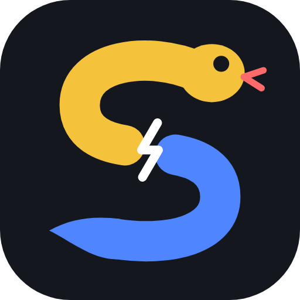

# Python Disconnected

Python, split into two pythons that each do one job.

**Quick look:** open `PREVIEW.html` in any browser or zip app — no install, no hosting, works offline.
It shows every example with its output, and (with internet) lets you edit and run programs live.

| | Blue Python 🔵 | Yellow Python 🟡 |
|---|---|---|
| Purpose | Basic programming | APIs, text managing, anything hard |
| Can use | math, variables, if/else, loops, functions, classes, lists, dicts, `print` | all of Python: `import`, files, web requests, string methods, regex… |
| Can't use | `import`, `open`, `input`, `eval`, text methods (`.split()`, `.replace()`, `.strip()`…), hidden `__attributes__` | — |
| Talks to the other by | using the variables Yellow gave it | `give("name", value)` |
| When it runs | at the very end, only when Yellow calls it | first |

## The one big rule

**Yellow must end by executing Blue.** The last line of Yellow is always `blue()`.
Everything Yellow `give()`s is only *registered* at that moment — if Yellow
doesn't end with `blue()`, nothing is registered and Blue never runs.

## A program

A `.pyd` file has two sections. Yellow first, Blue last:

```python
:: yellow ::
import json
data = json.loads('{"a": 2, "b": 3}')
give("a", data["a"])
give("b", data["b"])
blue()

:: blue ::
print("sum is", a + b)
```

Yellow can only give Blue *basic data*: numbers, text, `True`/`False`/`None`,
and lists / tuples / sets / dicts of those. Modules, files, and API objects stay
in Yellow.

A `.blue` file is a Blue-only program for plain logic (see `examples/fizzbuzz.blue`).

## Running

Needs Python 3.8+. No installs.

```bash
python3 pyd.py run examples/word_stats.pyd    # run a program
python3 pyd.py examples/fizzbuzz.blue         # shortcut for run
python3 pyd.py check myprogram.pyd            # check the rules without running
python3 pyd.py new myprogram                  # create myprogram.pyd from a template
```

## Examples

- `word_stats.pyd` — Yellow reads and cleans `story.txt`, Blue computes statistics.
- `weather_api.pyd` — Yellow calls the Open-Meteo weather API, Blue picks an outfit for each day (uses sample data when offline).
- `fizzbuzz.blue` — Blue on its own.
- `broken_no_blue.pyd` — what happens when Yellow forgets `blue()`.
- `broken_blue_text.pyd` — what happens when Blue tries to manage text.

## Errors

Errors say which python broke the rule, and where:

```
[yellow] broken_no_blue.pyd:6  Yellow must end by executing Blue: put  blue()  as the last line. Without it, nothing you give() is registered.
[blue] broken_blue_text.pyd:9  '.split()' is text managing - that's Yellow's job. Do it in Yellow and give() the result.
```

## Let your AI write it

This folder teaches AI coding tools the language, so they can make `.pyd` files for you:

- **Claude Code** — open a terminal here, run `claude`, then type `/pyd <what the program should do>`.
  It reads `CLAUDE.md` for the rules and the `/pyd` command writes, checks and runs the file.
- **Codex** — open a terminal here and run
  `codex "Make a Python Disconnected .pyd program that <...>. Follow AGENTS.md, then check and run it with python3 pyd.py."`
  Codex reads `AGENTS.md` automatically.
- **Any AI chat** (ChatGPT, Claude, Gemini…) — paste `AI-PROMPT.txt`, add what you want at the end,
  then save the answer as a `.pyd` file or paste it into the Playground in `PREVIEW.html`.

The **Connect AI** tab in `PREVIEW.html` builds these connect codes for you with a Copy button.

## Note

Blue's restrictions are a language rule, not a security sandbox — don't use
them to run untrusted code.
